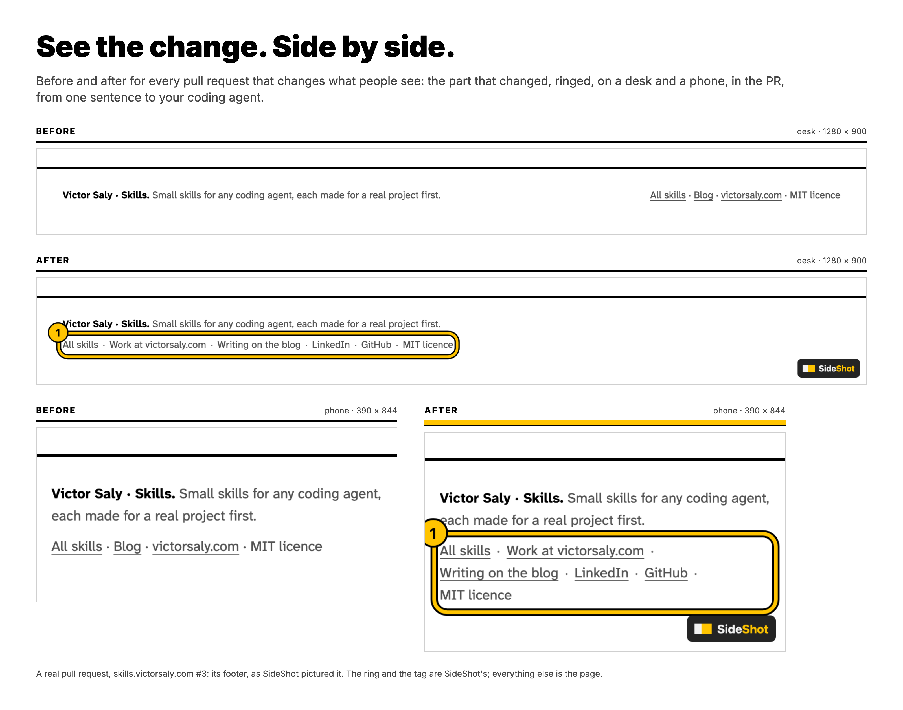
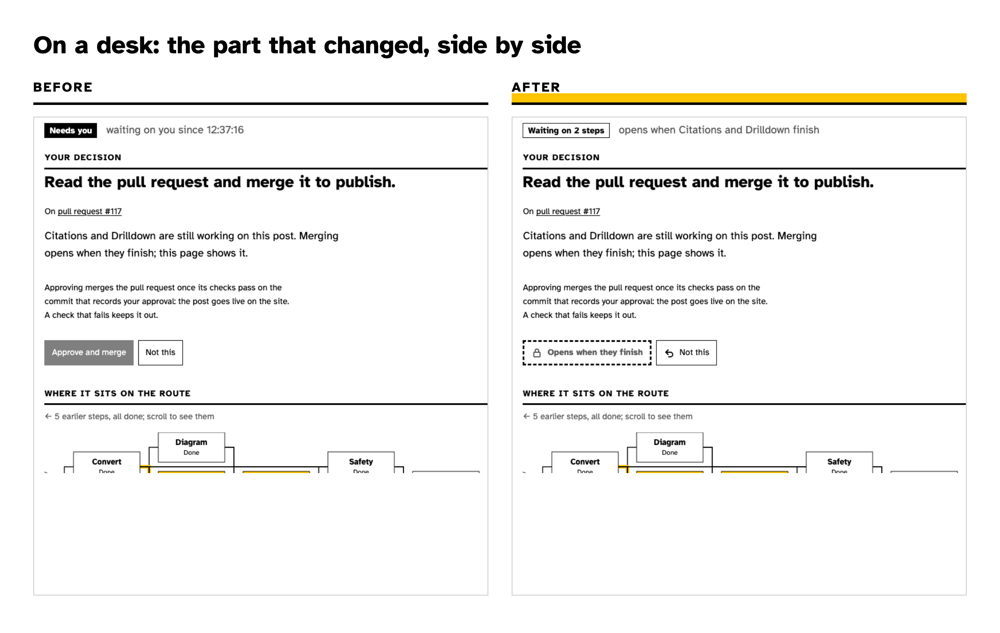
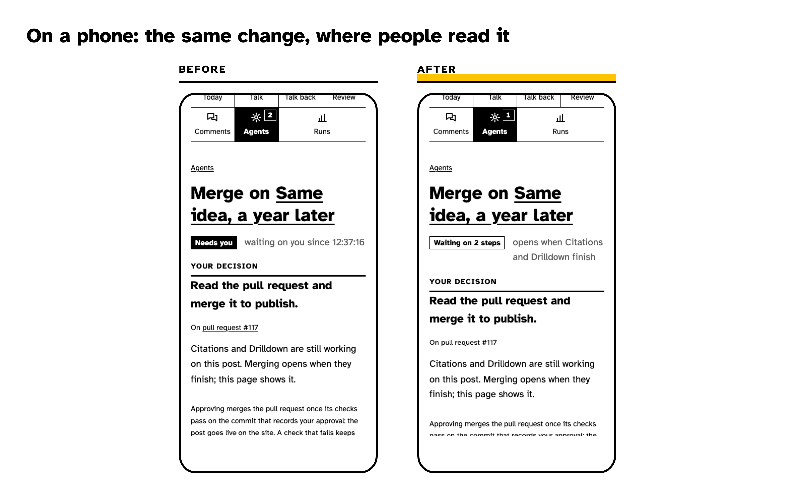
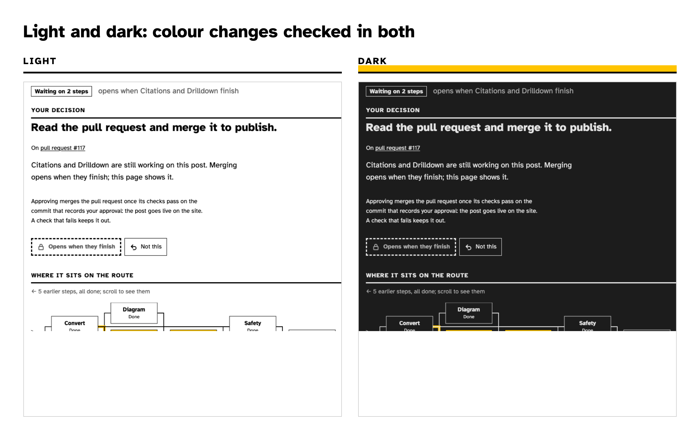
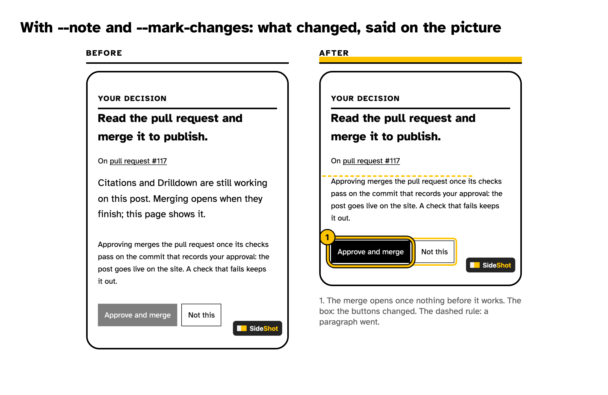
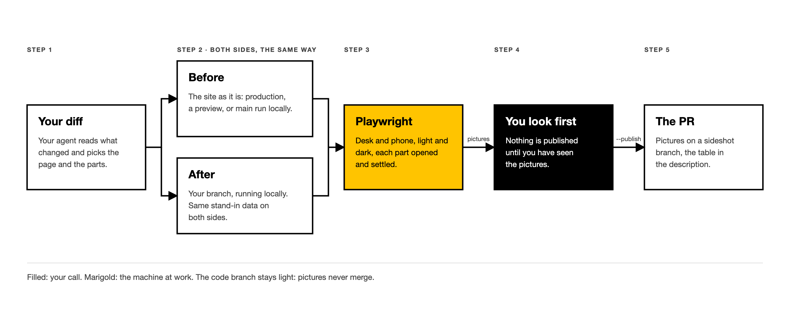

<p align="center">
  <picture>
    <source media="(prefers-color-scheme: dark)" srcset="docs/assets/lockup-dark.png" />
    
  </picture>
</p>
<h3 align="center">Before and after, for every pull request that changes what people see.</h3>

<p align="center"></p>

<p align="center">Tell your coding agent to <em>sideshot this PR</em>. It works out which page and which parts your change
touches, pictures them before and after on a desk and a phone (and in dark mode, if colours changed), rings and
marks what changed, shows you first, then puts the side-by-side table in the pull request. Reviewers see the change instead of imagining it.</p>

<p align="center">
  <a href="https://skills.victorsaly.com/sideshot"><strong>See it at work</strong></a> &nbsp;·&nbsp;
  <a href="#start"><strong>Get started</strong></a> &nbsp;·&nbsp;
  <a href="#what-you-get"><strong>What you get</strong></a> &nbsp;·&nbsp;
  <a href="#how-it-works"><strong>How it works</strong></a> &nbsp;·&nbsp;
  <a href="#options"><strong>Options</strong></a>
</p>

<p align="center">
  <a href="https://skills.sh"></a>
  
  <a href="https://github.com/victorsaly/sideshot/actions/workflows/check.yml"></a>
  <a href="LICENSE"></a>
</p>

<a id="start"></a>

## Install, then ask

One skill, any coding agent that reads [Agent Skills](https://skills.sh):

```bash
npx skills add victorsaly/sideshot -g
```

Then, on a branch with a pull request:

```text
SideShot this PR: the pricing table changed. Compare it with production, on desk and phone.
```

Then carry on: *"add dark mode"*, *"also the checkout page"*, *"put it in the PR"*.

<details>
<summary>Claude Code plugin, and other ways in</summary>

**Claude Code**, as a plugin (updates come through `/plugin`):

```text
/plugin marketplace add victorsaly/sideshot
/plugin install sideshot@sideshot
```

Then type `/sideshot` or just ask. From a terminal: `claude plugin marketplace add victorsaly/sideshot` and
`claude plugin install sideshot@sideshot`.

**By hand**, no agent at all: copy `skills/sideshot/` anywhere and run its script (see [Options](#options)).

</details>

<a id="what-you-get"></a>

## What you get

Real pictures, from a real pull request: a studio page whose merge button learned to wait while work was still
running ([agentic-blog #151](https://github.com/victorsaly/agentic-blog/pull/151)).

| On a desk | On a phone | Light and dark |
|---|---|---|
| [](docs/assets/example-desk.png) | [](docs/assets/example-phone.png) | [](docs/assets/example-dark.png) |
| The part that changed, not the whole page, so before and after line up. | The same change where most people read it. | Colour and contrast checked in both themes. |

Add `--note` and `--mark-changes` and the picture says what changed: a numbered ring on what the change is about
(its words go under the table), a box on everything else that differs, a dashed rule where something went.

<p align="center"></p>

- **What changed, said on the picture.** A numbered ring around what the change is about, with its words under
  the table, and an outline on everything else that differs. Content that only moved is left alone.
- **Your screens, not ours.** Desk and phone by default; tablet, laptop, wide, or any size you name.
- **A colour that stands out on your page.** Marks are marigold unless your page is marigold too; then SideShot
  picks the colour your pictures use least.
- **Pictures that stay out of your code.** They live on a `sideshot` branch that never merges.
- **A table that does not pile up.** The description gets one before/after table between markers; running again
  replaces it.
- **You look first, and what you saw is what goes in.** One overview sheet a part, before beside after, to look
  over; then `--reuse` publishes those same pictures, not new ones.
- **Quick.** Pictures are taken four at a time, and each page waits once, not three times: eight pictures in
  about seven seconds.
- **Honest about gaps.** A part that is new or removed shows as *(not there)* on one side, and the run says so.
- **Nothing to compare, said plainly.** A pair the same before and after is left out, and named under the table.
  When nothing is left, nothing is pushed, and the description says why.

<a id="how-it-works"></a>

## How it works

<p align="center">
  <picture>
    <source media="(prefers-color-scheme: dark)" srcset="docs/assets/how-dark.png" />
    
  </picture>
</p>

- **Before** is the site as it is: production, a preview deploy, or `main` run locally when the page sits behind a
  login.
- **After** is your branch, running locally.
- **Pages with live data** only production can reach get the same stand-in data on both sides, so only your change
  differs (a small `--setup` file, below).

## Quick start

1. **Install** with `npx skills add victorsaly/sideshot -g` (or the Claude Code plugin above).
2. **Have Playwright**: in the project (`npm i -D playwright && npx playwright install chromium`), or, for a
   project without Node (Python, Ruby, Go, a static site), globally (`npm i -g playwright`). Your agent asks
   before adding it.
3. **Ask on a branch with a PR**: *"SideShot this PR"*. Add `.sideshot/` to `.gitignore`.

Optional: save where *before* and *after* live in `.sideshot.json`, so later runs need nothing else:

```json
{ "before": "https://example.com", "after": "http://localhost:4321",
  "devices": { "web": "desk", "mobile": "phone", "kiosk": "1080x1920" } }
```

<a id="options"></a>

<details>
<summary><strong>Options</strong>, for running the script yourself</summary>

```bash
node skills/sideshot/scripts/sideshot.mjs --pr 123 --page /pricing --part plans=#plans \
  --before https://example.com --after http://localhost:4321
```

| Option | What it does |
|---|---|
| `--pr 123` | The pull request the pictures belong to. |
| `--page /path` | The page to open on both sides. |
| `--part name=selector` | A part to picture; repeat for more. `--part page=body` for the whole page. |
| `--before URL` / `--after URL` | Where each side runs. |
| `--devices desk,phone` | Where to picture it, at 2x. Names: `desk`/`web` 1280×900, `phone`/`mobile` 390×844, `tablet` 820×1180, `laptop` 1440×900, `wide` 1920×1080. Or sizes: `1024x768`, `pixel=412x915:mobile`. |
| `--schemes light,dark` | Light, dark, or both. |
| `--click "selector"` | Something to press first: a tab, a panel, a menu. |
| `--note "selector=words"` | Rings that element on the after picture with a number; the words go under the table. Repeat. |
| `--mark-changes` | Outlines what was added or changed; a dashed rule where something was taken out. |
| `--accent auto` | The marking colour: `auto` (marigold, unless the page is close to it), `magenta`, `cyan`, `violet`, `lime`, or `#hex`. |
| `--no-watermark` | Leaves off the small SideShot tag in the corner of each "after" picture. |
| `--setup ./file.mjs` | Runs on each page before it opens: stand-in data, a cookie, a login. |
| `--wait 1500` | How long a part is given to settle once it is in view, before it is pictured. |
| `--jobs 4` | How many pictures are taken at once. |
| `--publish` | Pushes the pictures to the `sideshot` branch and prints the table. |
| `--update-pr` | Also writes the table into the PR description (needs the GitHub CLI). |
| `--reuse` | With `--publish` or `--update-pr`: publishes the pictures already taken, as they are. |
| `--prune [--older-than 30]` | Takes off the `sideshot` branch the pictures of pull requests closed or merged at least that many days ago (30 unless said), so the repository does not grow for ever. The branch becomes one commit of what is left, and those pull requests no longer show their pictures. |

`--pr` can be left out when the GitHub CLI finds the branch's pull request. `--help` lists everything.

A `--setup` file, for a page whose data only production can reach:

```js
export default async (page, { when, device, scheme }) => {
  await page.route('**/api/runs', (route) => route.fulfill({ json: { runs: [] } }));
};
```

</details>

## Where it comes from

SideShot grew out of [agentic-blog](https://github.com/victorsaly/agentic-blog), where every pull request that
changes a page carries its before and after; it has been taking those pictures there since
[#111](https://github.com/victorsaly/agentic-blog/pull/111), and became its own tool in October 2026.

## Working on SideShot

The skill needs nothing installed beyond Playwright in the project it runs in. To work on it here:

```bash
npm install && npx playwright install chromium
npm test                # what it is asked, checked, and the table it writes
npm run test:coverage   # the same, with at least 90% of lib.mjs covered
npm run test:e2e        # pictured for real in Chromium, what draw.mjs marks, and publishing to a local repo
npm run lint            # ESLint
npm run typecheck       # TypeScript checks the JavaScript, nothing is built
npm run check           # all of the above, as CI runs it on every pull request
```

What changed in each version is in [CHANGELOG.md](CHANGELOG.md).

## Licence

MIT, © Victor Saly
