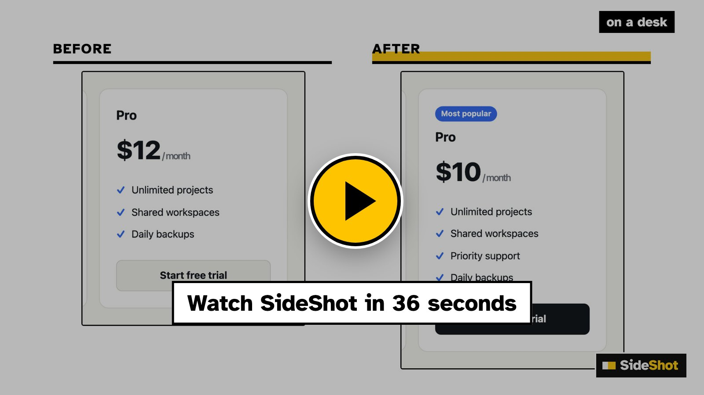

<p align="center">
  <picture>
    <source media="(prefers-color-scheme: dark)" srcset="docs/assets/lockup-dark.png" />
    
  </picture>
</p>
<h3 align="center">Before and after, for every pull request that changes what people see.</h3>

<p align="center"></p>

<p align="center"><strong>A diff cannot show a UI change.</strong> Tell your coding agent to
<em>sideshot this PR</em>. It works out which page and which parts your change touches, pictures them before and after
on a desk and a phone (and in dark mode, if colours changed), rings and marks what changed, shows you first, then puts
the side-by-side table in the pull request. Reviewers see the change on desk and phone without checking out the
branch.</p>

<p align="center"><a href="https://skills.victorsaly.com/sideshot#film"></a></p>

<p align="center">
  <a href="https://skills.victorsaly.com/sideshot#film"><strong>Watch the film</strong></a> &nbsp;·&nbsp;
  <a href="https://skills.victorsaly.com/sideshot"><strong>See it at work</strong></a> &nbsp;·&nbsp;
  <a href="#start"><strong>Get started</strong></a> &nbsp;·&nbsp;
  <a href="#what-you-get"><strong>What you get</strong></a> &nbsp;·&nbsp;
  <a href="#how-it-works"><strong>How it works</strong></a> &nbsp;·&nbsp;
  <a href="#options"><strong>Options</strong></a> &nbsp;·&nbsp;
  <a href="#when-something-goes-wrong"><strong>When something goes wrong</strong></a>
</p>

<p align="center">
  <a href="https://skills.sh"></a>
  
  <a href="https://github.com/victorsaly/sideshot/actions/workflows/check.yml"></a>
  <a href="LICENSE"></a>
</p>

<a id="start"></a>

## Install, then ask

**What it needs:** Node 22 or later and git; Playwright with its Chromium, in the project or installed globally (your
agent asks before adding it); and, to put the pictures in a pull request, the GitHub CLI (`gh`), signed in. It works
on any site you can open in a browser, whatever it is built with.

One skill, any coding agent that reads [Agent Skills](https://skills.sh):

```bash
npx skills add victorsaly/sideshot -g
```

`-g` puts it in your home folder, for every project; leave it out for this project only. The same line serves Claude
Code, Codex, Cursor, OpenCode and the other agents the `skills` command knows: it asks which of yours to put it in, or
name them with `-a` (`-a '*'` for all). Add `.sideshot/` to `.gitignore`: the pictures are taken there. Then, on a
branch with a pull request:

```text
SideShot this PR: the pricing table changed. Compare it with production, on desk and phone.
```

Then carry on: *"add dark mode"*, *"also the checkout page"*, *"put it in the PR"*.

A **part** is the piece of the page your change touches, named and found with a CSS selector (`plans=#plans`); SideShot
pictures the part, not the whole page, so before and after line up. **Desk** and **phone** are its two screens unless
you name others (1280×900 and 390×844).

Save where *before* and *after* live in `.sideshot.json` at the project's root, so later runs need only the parts:

```json
{ "before": "https://example.com", "after": "http://localhost:4321",
  "devices": { "web": "desk", "mobile": "phone", "kiosk": "1080x1920" } }
```

<details>
<summary>Claude Code plugin, and other ways in</summary>

**Claude Code**, as a plugin (updates come through `/plugin`):

```text
/plugin marketplace add victorsaly/sideshot
/plugin install sideshot@sideshot
```

Then type `/sideshot` or just ask. From a terminal: `claude plugin marketplace add victorsaly/sideshot` and
`claude plugin install sideshot@sideshot`.

**By hand**, no agent at all: copy `skills/sideshot/` anywhere and run its script (see [Options](#options)).

</details>

<a id="what-you-get"></a>

## What you get

Real pictures, from a real pull request: a studio page whose merge button learned to wait while work was still
running ([agentic-blog #151](https://github.com/victorsaly/agentic-blog/pull/151)).

| On a desk | On a phone | Light and dark |
|---|---|---|
| [](docs/assets/example-desk.png) | [](docs/assets/example-phone.png) | [](docs/assets/example-dark.png) |
| The part that changed, not the whole page, so before and after line up. | The same change where most people read it. | Colour and contrast checked in both themes. |

Add `--note` and `--mark-changes` and the picture says what changed: a numbered ring on what the change is about
(its words go under the table), a box on everything else that differs, a dashed rule where something went.

<p align="center"></p>

- **What changed, said on the picture.** A numbered ring around what the change is about, with its words under
  the table, and an outline on everything else that differs. Content that only moved is left alone, and so is a
  card beside the one that changed.
- **Your screens, not ours.** Desk and phone by default; tablet, laptop, wide, or any size you name.
- **A colour that stands out on your page.** Marks are marigold unless your page is marigold too; then SideShot
  picks the colour your pictures use least.
- **Pictures that stay out of your code.** They live on a `sideshot` branch that never merges, and `--prune`
  takes off the pictures of pull requests closed long ago, so it does not grow for ever.
- **A table that does not pile up.** The description gets one before/after table between markers; running again
  replaces it.
- **You look first, and what you saw is what goes in.** Each run makes one overview sheet for each part, every
  before beside its after. When they look right, `--reuse` publishes those same pictures instead of taking new ones.
- **Quick.** Pictures are taken four at a time, and each page is loaded and settled once for all its pictures:
  eight pictures in about seven seconds.
- **Honest about gaps.** A part that is new or removed shows as *(not there)* on one side, and the run says so.
- **Nothing to compare, said plainly.** A pair the same before and after is left out, and named under the table.
  When nothing is left, nothing is pushed, and the description says why.

### Instead of screenshots by hand

```diff
- Open the site as it is and your branch, side by side.
- Picture the part on each: desk and phone, light and dark, before and after. Eight pictures.
- Crop every pair so it lines up, upload them, and type the table.
- Do it all again after every review comment.
+ One sentence to your agent. Eight pictures of a small page take about seven seconds.
+ Cropped to the part and lined up, with what changed marked.
+ The table written into the pull request, and replaced, not added to, on the next run.
```

<a id="what-it-writes"></a>

## What it writes, and who sees it

- **On your machine:** the pictures, in `.sideshot/<pull request>/`. Nothing leaves it until you say so.
- **With `--publish`**, after you have looked: one commit of those pictures to the `sideshot` branch on `origin`
  (the picture branch; `--branch` names another). It never merges, so your code stays as it was.
- **With `--update-pr`**: the table, between markers in the pull request's description. Running again replaces it.

Anyone who can read the repository can see the pictures, so **on a public repository they are public**; on a private
one, only those who can read it see them, in the table as well. They stay on the `sideshot` branch until `--prune`
takes them off. Picture nothing you would not put in the pull request
yourself. SideShot sends nothing anywhere else, and costs nothing; your agent's own use is all you pay for.

<a id="how-it-works"></a>

## How it works

<p align="center">
  <picture>
    <source media="(prefers-color-scheme: dark)" srcset="docs/assets/how-dark.png" />
    
  </picture>
</p>

- **Before** is the site as it is: production, a preview deploy, or `main` run locally when the page sits behind a
  login.
- **After** is your branch, running locally.
- **Live data.** When a page reads data only production can reach (an API behind a login, a database), a small
  `--setup` file gives both sides the same stand-in data, so only your change differs (below).

To install Playwright: `npm i -D playwright && npx playwright install chromium` in the project, or, for a project
without Node (Python, Ruby, Go, a static site), `npm i -g playwright && npx playwright install chromium`.

<a id="options"></a>

<details>
<summary><strong>Options</strong>, for running the script yourself</summary>

```bash
node skills/sideshot/scripts/sideshot.mjs --pr 123 --page /pricing --part plans=#plans \
  --before https://example.com --after http://localhost:4321
```

| Option | Unless said | What it does |
|---|---|---|
| `--pr 123` | this branch's | The pull request the pictures belong to, found with the GitHub CLI when left out. |
| `--page /path` | `/` | The page to open on both sides. |
| `--part name=selector` | *needed* | A part to picture; repeat for more. `--part page=body` for the whole page. |
| `--before URL` | *needed* | Where the site runs as it is: production, a preview, or `main` run locally. Can live in `.sideshot.json`. |
| `--after URL` | `http://localhost:3000` | Where this branch runs. |
| `--devices list` | `desk,phone` | Where to picture it, at 2x. Names: `desk`/`web` 1280×900, `phone`/`mobile` 390×844, `tablet` 820×1180, `laptop` 1440×900, `wide` 1920×1080. Or sizes: `1024x768`, or your own name, `pixel=412x915:mobile` (`:mobile` for a touch screen). |
| `--schemes list` | `light` | `light`, `dark`, or `light,dark`. |
| `--click "selector"` | | Something to press first: a tab, a panel, a menu. |
| `--note "selector=words"` | | Rings that element on the after picture with a number; the words go under the table. Repeat. |
| `--mark-changes` | off | Outlines what was added or changed; a dashed rule where something was taken out. |
| `--accent colour` | `auto` | The marking colour: `auto` (marigold, unless the page is close to it), `marigold`, `magenta`, `cyan`, `violet`, `lime`, or `#hex`. |
| `--no-watermark` | | Leaves off the small SideShot tag in the corner of each "after" picture. |
| `--setup ./file.mjs` | | Runs on each page before it opens: stand-in data, a cookie, a login. |
| `--wait ms` | `1500` | How long, in milliseconds, a part is given to settle once it is in view, before it is pictured. |
| `--jobs N` | `4` | How many pictures are taken at once. |
| `--out folder` | `.sideshot` | Where the pictures go, in a folder for the pull request. |
| `--publish` | | Pushes the pictures to the picture branch and prints the table. |
| `--update-pr` | | Also writes the table into the PR description (needs the GitHub CLI). |
| `--reuse` | | With `--publish` or `--update-pr`: publishes the pictures already taken, as they are. |
| `--branch name` | `sideshot` | The picture branch, which never merges. |
| `--prune` | | Takes off the picture branch the pictures of pull requests closed or merged a while ago, so the repository does not grow for ever. The branch becomes one commit of what is left, and those pull requests no longer show their pictures. Needs the GitHub CLI, not a browser. |
| `--older-than days` | `30` | With `--prune`: how long ago. |

Every option but `--part`, `--note`, `--publish`, `--update-pr`, `--reuse` and `--prune` can also live in
`.sideshot.json`, under its own name (`markChanges: true`, `watermark: false`, `olderThan`). `--help` lists everything.

A `--setup` file, for a page whose data only production can reach:

```js
export default async (page, { when, device, scheme }) => {
  await page.route('**/api/runs', (route) => route.fulfill({ json: { runs: [] } }));
};
```

</details>

<a id="when-something-goes-wrong"></a>

## When something goes wrong

SideShot says what went wrong, and your agent usually acts on it. It stops with exit 1 for what it was asked (a flag,
a server that does not answer, a push that is refused), 2 for what is missing (Playwright, its browser, the GitHub CLI),
and 3 when there is nothing to compare. When you are running the script yourself:

| It says | What to do |
|---|---|
| *Run SideShot from inside the project's git repository* | `cd` into the project first: SideShot works out the pull request and the branch from git. |
| *Nothing answers at …* | Start that server first (for after, the dev or preview server), or give its address with `--before` or `--after`. |
| *Playwright is not installed* (exit 2) | `npm i -D playwright && npx playwright install chromium`, or for a project without Node, `npm i -g playwright && npx playwright install chromium`. |
| *Playwright could not start Chromium* (exit 2) | Install its browser: `npx playwright install chromium`. |
| *Not on the page (new or removed): …* | The part is only on one side. Fine when the change adds or removes it; otherwise check `--part`'s selector. |
| *Could not press … for: …* | What `--click` names is not there on that side, so that side is pictured unpressed. |
| *The same before and after* (exit 3) | Check that `--after` runs this branch, and that `--page` and `--part` show the change. If it truly does not show there, `--update-pr --reuse` says so in the PR. |
| A picture of a page still drawing | Give it longer: `--wait 3000`. |
| It asks for `--pr` | No pull request for this branch yet, or more than one: open it, or name it with `--pr`. |
| *SideShot publishes only to an origin on GitHub* | `--publish` and `--update-pr` need the repository on GitHub; the pictures are still in `.sideshot/` without them. |
| *There are no pictures in … to publish* | `--reuse` publishes pictures already taken, and there are none: run without `--reuse` first. |
| *--update-pr needs the GitHub CLI* (exit 2), or *--prune needs* it | Install it from [cli.github.com](https://cli.github.com), or sign in: `gh auth login`, then `gh auth status` to check. Said before anything is pictured or pushed. |
| *git could not push the pictures to sideshot on origin* | What git said follows. Check that you can push to the repository, then run again with `--reuse`: the pictures are still in `.sideshot/`. |
| *git could not push the pruned sideshot to origin* | Nothing was taken off. If someone pushed to the `sideshot` branch since it was read, run it again. |

Something else? [Open an issue](https://github.com/victorsaly/sideshot/issues/new/choose) with the command you ran
and what it said.

## Where it comes from

SideShot grew out of [agentic-blog](https://github.com/victorsaly/agentic-blog), where every pull request that
changes a page carries its before and after; it has been taking those pictures there since
[#111](https://github.com/victorsaly/agentic-blog/pull/111), and became its own tool in October 2026.

## Working on SideShot

The skill needs Node 22, git and Playwright, in the project it runs in or globally, and nothing else. To work on it
here:

```bash
npm install && npx playwright install chromium
npm test                # what it is asked, checked, the table it writes, and the skill's own files
npm run test:coverage   # the same, with at least 90% of lib.mjs covered
npm run test:e2e        # pictured for real in Chromium, what draw.mjs marks, and publishing to a local repo
npm run lint            # ESLint
npm run typecheck       # TypeScript checks the JavaScript, nothing is built
npm run check           # all of the above, as CI runs it on every pull request
claude plugin eval . --judge-model sonnet --max-cost-usd 10   # whether agents use the skill as SKILL.md says
```

The evals, what each checks and how to run one cheaply, are in [evals/README.md](evals/README.md).

How to make a change, and release it, is in [CONTRIBUTING.md](CONTRIBUTING.md). What changed in each version is in [CHANGELOG.md](CHANGELOG.md), and in the
[releases](https://github.com/victorsaly/sideshot/releases).

## Licence

MIT, © Victor Saly
